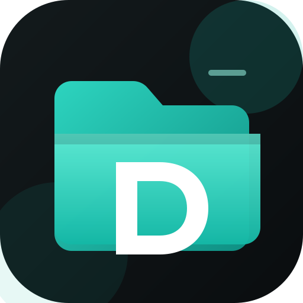

<p align="center">
  
</p>

<h1 align="center">Delve</h1>

<p align="center">
  A fast, adaptable GTK4 file manager for Linux, written in Rust.
</p>

Delve is a daily-driver file browser: five ways to look at a folder,
independent tabs, real file operations, archives, tags, previews, reusable
folder commands, and a theme system you can edit while the application is
running.

It is distribution-neutral. Delve does not depend on GNOME, KDE, Hyprland, DMS,
a particular icon pack, terminal, or desktop shell CSS. It needs GTK 4.10 or
newer and a normal XDG desktop.

**Current release: 1.0.1.** The interface icons are bundled inside the binary,
so Delve works offline and on minimal systems without an icon package.

## Install

Download the Linux tarball and `SHA256SUMS` from the release page, verify the
checksum, then install:

```sh
sha256sum -c SHA256SUMS
tar -xzf delve-1.0.1-linux-x86_64.tar.gz
cd delve-1.0.1-linux-x86_64

sudo ./install.sh          # system-wide, /usr/local
./install.sh --user        # per-user, ~/.local
```

The installer adds the binary, desktop entry, AppStream metadata, every
application icon size, the bundled icon theme, and documentation. It updates
desktop and icon caches when the tools are present. See
[Install on Linux](docs/install-linux.md) for prefixes, staged installs,
uninstalling, and troubleshooting.

### Native packages

Release 1.0.1 also ships native packages that pull in GTK 4.10+ and include the
complete bundled icon theme, so no separate icon package is needed:

```sh
sudo dpkg -i delve_1.0.1_amd64.deb          # Debian / Ubuntu
sudo dnf install ./delve-1.0.1-1.x86_64.rpm  # Fedora / RHEL
sudo pacman -U ./delve-1.0.1-1-x86_64.pkg.tar.zst  # Arch Linux
```

See [Install on Linux](docs/install-linux.md) for the full dependency list and
how to build them from the release tarball.

### Build from source

Debian / Ubuntu packages:

```sh
sudo apt install build-essential pkg-config libgtk-4-dev libglib2.0-dev-bin
```

Then:

```sh
cargo build --release --locked
sudo ./scripts/install.sh
```

Rust 1.80 or newer is required. `glib-compile-resources` from
`libglib2.0-dev-bin` embeds the icon theme during the build. Release builds do
not download assets and need no network access.

Run without installing:

```sh
./target/release/delve ~/Downloads
```

## Documentation

| Guide | Contents |
| --- | --- |
| [Documentation index](docs/README.md) | The full documentation map and requirements. |
| [User guide](docs/user-guide.md) | Views, tabs, operations, tags, archives, settings, storage, and every default shortcut. |
| [Install on Linux](docs/install-linux.md) | Tarball, source, per-user and system installs, verification, and removal. |
| [Build and release](docs/build-and-release.md) | Toolchain, release builds, metadata validation, packaging, and the release checklist. |
| [Support](docs/support.md) | Diagnostics, logs, recovery, common problems, and report templates. |
| [Folder commands](docs/folder-commands.md) | Command-set scopes, argv rules, execution modes, quick slots, and safety. |
| [Theme format](docs/theme-format.md) | Tokens, metrics, typography, extra CSS, validation, and live reload. |
| [Bundled icons](assets/icons/README.md) | Icon provenance, licensing, counts, and refresh instructions. |

## What it does

### Five synchronised views

Icon, Detail, Recursive, Treemap, and Graph views share the same selection, sort
order, filter, tags, and file operations. Switching views never changes what is
selected.

- **Icon** — flow grid with thumbnails, configurable icon size, rubber-band
  selection, and drag and drop.
- **Detail** — sortable columns for name, type, size, modified time,
  permissions, owner, and tags, with per-column visibility.
- **Recursive** — flattened tree of the current folder with depth control and
  expand/collapse.
- **Treemap** — squarified size map with zoom into subfolders and file/folder/
  media filters.
- **Graph** — radial folder overview with pan, zoom, and search.

Folder scans run on worker threads and can be cancelled. Treemap and Graph use
bounded scans so a pathological tree cannot freeze the UI.

### Tabs and navigation

Independent history, view, sort/filter, selection, and scroll position per tab.
Create, duplicate, close, close others, close to the right, and reopen closed
tabs. Drag to reorder; middle-click to close. Sidebar sections cover Places,
Tags, Library (Recent and Trash), Network mounts, and System mounts. The sidebar
and inspector collapse into drawers on narrow windows.

### File operations

- Copy, cut, and paste with conflict handling: ask, replace, skip, or keep both.
- Rename in a popover with validation and conflict checks; duplicate; create
  folder; multi-selection operations.
- Move to Trash, restore from Trash, and confirmed permanent deletion.
- Drag and drop between folders, panes, and tabs.
- **Organise** builds a file move plan from extension, category, modified month,
  size range, or first letter, with a preview before applying.
- Properties with permissions, ownership, timestamps, link status, and
  off-thread recursive folder size calculation.

### Archives

Create ZIP, TAR, and TAR.GZ archives; extract them from the toolbar or context
menu. Extraction refuses absolute paths and entries that would escape the
destination. Existing files follow the conflict policy.

### Tags, colours, and previews

Tags are keyed to stable file identity where the filesystem provides it, with a
path fallback. Folder colours render in the sidebar and file views. Image
thumbnails and text previews are generated in the background; the inspector
shows metadata, tags, and colour controls.

### Commands and terminal

Folder command sets support scoped availability, multiple steps, sequential,
parallel, or mixed-group execution, environment variables, argument
placeholders, `Shift+S` quick slots, a multi-set picker, streamed background
output, a detached run window, and a separate-terminal mode. Every command is an
argv list, never an implicitly interpreted shell string. See
[Folder commands](docs/folder-commands.md).

Terminal detection scans `PATH`; nothing is hard-coded to a desktop. Configure
an explicit template in **Settings → Terminal** if needed.

### Themes and icons

Delve owns its token-based design system and does not import desktop shell CSS.
It includes Delve Dark, Delve Light, and Delve Ember. Custom themes are plain
JSON plus optional CSS, validated before use and reloaded live. Density, UI and
monospace fonts, accent colour, background opacity, and translucent panels are
configurable.

The complete **Delve** icon theme is embedded in the executable. Host icon
packages are optional. Custom file-type and folder icons can be assigned in
Settings.

### Optional LocalSend transfers

Delve can discover and send files to LocalSend devices. Discovery runs only when
the transfer panel is open, and missing LocalSend support never blocks startup
or any other feature. Receiving is not implemented in 1.0.0.

### Privacy and storage

Delve has no telemetry, analytics, crash uploader, or built-in update checker.
It does not download themes or assets at runtime. Settings, tags, themes, and
caches follow XDG:

| Purpose | Default path |
| --- | --- |
| Settings | `~/.config/delve/settings.json` |
| Tags and folder colours | `~/.local/share/delve/metadata.json` |
| Custom icon assets | `~/.local/share/delve/icons/` |
| Themes | `~/.config/delve/themes/` |
| Thumbnail cache | `~/.cache/delve/thumbnails/` |
| Log | `~/.local/share/delve/delve.log` |

Uninstalling preserves these directories. Settings are schema-versioned and
written atomically; invalid files are backed up and defaults are used instead of
failing to start.

## Design notes

- GTK4 only, no libadwaita requirement, no shell extensions.
- No Git or GitHub integration.
- No hard-coded home directory, username, terminal, font, icon theme, or screen
  resolution.
- Destructive actions are explicit; Trash is the default.
- Long work runs on threads and reports progress in a cancellable operation
  window.
- High-DPI friendly, responsive layout, and keyboard-first operation with
  editable shortcuts.

## Known limitations

- LocalSend supports discovery and sending only. Receiving and TLS certificate
  pinning for self-signed peers are not implemented.
- Video and PDF previews are shown as file-type icons rather than decoded
  frames.
- Archive support is limited to ZIP, TAR, and TAR.GZ.
- Graph and Treemap use bounded scans; extremely large trees may not show every
  node.
- Organise performs real moves, not virtual grouping.
- Rename uses a popover rather than an inline editable cell.

## Testing and support

There is no automated test suite yet. Releases are verified with release builds,
desktop and AppStream metadata validation, staged installs, and manual runtime
checks. The exact checklist is in
[Build and release](docs/build-and-release.md#release-checklist).

For help, read [Support](docs/support.md). It covers diagnostics, log collection,
clean-configuration testing, recovery from a bad settings file, and the
information to include in a report.

## License

Delve's source code and original artwork are licensed under the MIT License.
See [LICENSE](LICENSE).

The bundled icon theme is derived from Adwaita and is distributed under its own
terms. See [assets/icons/COPYING.ADWAITA](assets/icons/COPYING.ADWAITA) and
[assets/icons/README.md](assets/icons/README.md). Those terms apply only to the
theme artwork, not to Delve's source.
